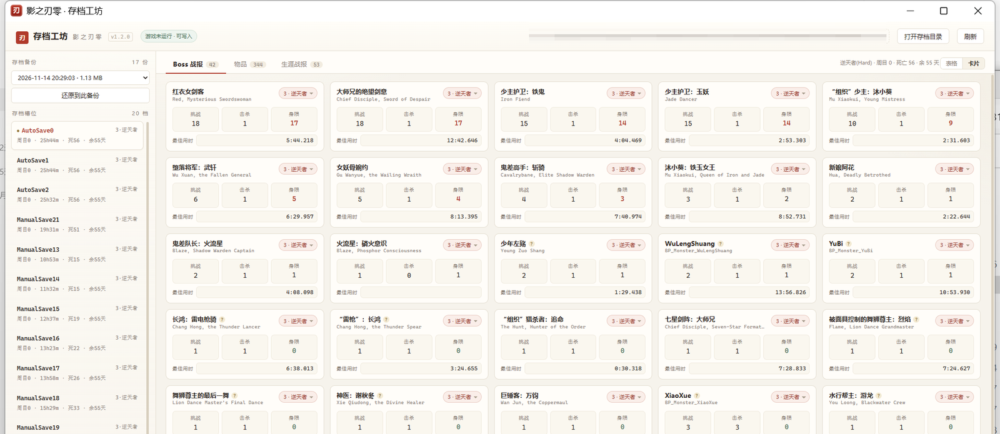

# Phantom Blade Zero · Save Studio

> v1.2.0 · A small Windows desktop tool for viewing and editing your local
> *Phantom Blade Zero* save: boss records (attempts / kills / deaths / best time),
> difficulty and item counts — with automatic backups on every write.



English | [中文](README.zh_cn.md)

## Features

- **Native desktop window** (WebView2): no console, no browser, with an application icon
- **Three tabs**: Boss records / Items / Career records (a read-only cross-slot, cross-cycle ledger)
- **Two views**: Boss records can be shown as a table or as cards, one boss per card, for quick scanning
- **One-click locate**: the "Open save folder" button selects `PBZSaveGame.sav` directly in Explorer
- **Manual save location**: click the path box to pick the save or point at `PBZ.exe` by hand, so non-Steam builds (WeGame etc.) work too; the choices are stored in `sav_path.txt` / `exe_path.txt` next to the exe
- **Boss records**: attempts, kills, deaths and best time listed per difficulty/cycle, all editable; click a header to sort
- **Items**: 275 item counts, searchable and editable, with filtering
- **Safe**: a `.bak-<timestamp>` backup before every write, untouched slots reuse their original ciphertext block, and new files are fully validated before an atomic replace
- **Offline**: the save is read locally, the server only binds `127.0.0.1`, nothing is uploaded

## Disclaimer

- For **single-player, offline** saves only. Back up your own saves; use at your own risk
- The repository **does not** include any game file, asset or RAD Oodle runtime — you need the game installed locally
- Not affiliated with S-GAME; this is an unofficial tool

## Conclusion: it is editable, and no memory editor is needed

The save `PBZSaveGame.sav` is a **PBZS v3** custom container: a 12-byte plaintext header, an AES-256-GCM encrypted directory block, and one independently encrypted block per slot (Oodle Kraken compressed, zlib also accepted). The key is not account-bound but a build constant — it can be recovered by XOR-ing the 64 bytes following the `sealed but block is PLAINTEXT` anchor inside `platform\steam\PBZ.exe`. So you can edit, re-encrypt and write back, and the game reads it normally.

The real data all lives in the slot JSON, and the three things you care about have explicit fields:

| What you want | Field | Notes |
|---|---|---|
| Difficulty | `PBZGameSystem.DifficultModeByte` | 0=Handicapped 1=Easy 2=Normal 3=Hard 4=Nightmare (enum taken from `EDifficultMode` in PBZ.exe) |
| Boss death count | `BossRecord.<Boss>.Records["<cycle>_<difficulty>"].AttemptCount / KillCount` | deaths = AttemptCount − KillCount; keys look like `0_3` ("cycle_difficulty") |
| Kill time | same `.BestTimeMs` | milliseconds |
| Total deaths | `PBZDeathMeta.DiedTimes` | one per slot |
| Career records | `__Advanced__.BossRecord.<Boss>.Records["<difficulty>"]` | has an extra `Cycle` field; the key is the difficulty only, no cycle |

Note: **a slot's `BossRecord` and the `__Advanced__` career records are two separate data sets.** Both the "deaths / fastest kill" figures in the UI can come from either, so the tool edits both by default.

### How the two record sets differ

| | Per-slot records `BossRecord` | Career records `__Advanced__.BossRecord` |
|---|---|---|
| Location | One per ManualSave/AutoSave, travels with the save | A special slot in the save package, unique per account, belonging to no slot |
| Key | `"<cycle>_<difficulty>"`, e.g. `0_3` | The difficulty only, e.g. `"3"`; the cycle lives in the record's `Cycle` field |
| Lifetime | Changes with the slot; loading an old save shows old data | Only grows, accumulating across cycles and saves |
| Does restoring roll it back | Yes (back to that snapshot) | **No** — it lives in `__Advanced__`, so restoring or overwriting a single slot never touches it |

Measured evidence (from an actual save): `ZuoShang` shows `1 attempt 1 kill` in a slot but `2 attempts 2 kills` in the career ledger; `WuXuan` has only a `0_3` record in a slot while the career ledger holds both difficulty `1` and `3`. In other words, restoring from a backup rolled the slot back while the career ledger kept moving forward.

### Boss names

`boss_names.json` maps internal keys to Chinese/English display names, and both the tool and the UI read it:

```json
"BP_Monster_WuXuan": { "cn": "堕落将军：武轩", "en": "Wu Xuan, the Fallen General", "verified": true }
```

- Names come from the **Xiaoheihe "Phantom Blade Zero save analysis" boss codex** (75 official translations, more accurate than English wiki re-translations)
- Internal keys are the character names in pinyin (`GuWanYue`=骨婉约, `Zhuobi`=拙壁, `YuZan`=玉瓒, `CanQu`=残躯); where the pinyin matches, the name is confirmed directly
- Where the pinyin does not match (e.g. `LuanShi`, `GuiChai_Yellow_MoDao`), the **best time** is used to align with a codex card: `LuanShi` 2:05.526 ↔ codex "拳痴：铁狂 2:05", `GuiChai_Yellow_MoDao` 7:40.974 ↔ "鬼差高手：斩骑 7:40"
- Entries with `verified: false` show a `?` in the UI: `HookMan`, `GuiChai_Yellow_ShuangGou`, `GuiChai_Red_P2`, `EMei_Sword_Top`, `HuaShan_*` — these could not be uniquely matched to a codex card
- To rename, edit this JSON and restart (one copy sits next to the exe, another next to the source). The file's `_version` is used to overwrite older name tables on upgrade; if you have customised names, raise `_version` too so it is not overwritten

### Changing one slot's difficulty

- Web UI: the "slot difficulty" dropdown to the right of the boss-card title changes **only the currently selected slot**
- Web UI, bulk: "Global edits → difficulty + scope" at the top
- Each row's difficulty pill in the table is also a dropdown, which moves **that single record** to another difficulty (key `0_3` → `0_2`, with the career record renamed to follow)
- Command line: `python pbz_tool.py set-difficulty 3 --slots ManualSave17`, `python pbz_tool.py move-records --from 1 --to 3`

## Usage 0: double-click the exe (desktop window, no console, no browser)

`dist\PhantomBladeZero-SaveStudio.exe` — double-clicking opens a native window (WebView2 / Edge engine) with no black console and no browser. The full UI lives inside the window; closing it quits.

- Technically: an in-process server binds a random ephemeral port on `127.0.0.1`, and pywebview hosts it in a window; the port is random and never exposed
- Startup writes `app.log` next to the exe (records the local address used, for troubleshooting)
- Requires the system WebView2 Runtime (present by default on Win10 1903+ / Win11; if missing, a dialog appears — install Microsoft's Evergreen version)
- `PhantomBladeZero-SaveStudio-server.exe` is the same code in the older "console + browser" form, kept for debugging

### UI layout (v1.3)

```
┌──────────────────────────────────────────────────────┐
│ 刃 Save Studio Phantom Blade Zero v1.3  [status] …path… Refresh │
├──────────┬───────────────────────────────────────────┤
│ Backups  │  Boss records 34 │ Items 277   current slot info │
│ [sel][restore]│ ────────────────────────────────────── │
│ Slots    │  Boss | Diff | Attempts | Kills | Deaths | Time │
│ · AutoSave0│  …(click headers to sort; only this scrolls) │
│ · …        │                                          │
├──────────┴───────────────────────────────────────────┤
│ Pending: N changes   last message    [Discard][Preview][Write] │
└──────────────────────────────────────────────────────┘
```

- The outer shell does not scroll: `html/body` are pinned to 100vh with `overflow:hidden`, so only the slot list, boss table and item table scroll internally
- Backup selection and restore sit at the top of the left column; a `.bak-<timestamp>` is still generated before writing
- The bottom action bar has a fixed height and 22px side padding, so it no longer hugs the edge

## Usage 0.5: double-click the exe (older form: console + browser)

`dist\PhantomBladeZero-SaveStudio.exe` — double-click, no Python needed. It opens the browser at `http://127.0.0.1:8765`; the black window is the server itself, and closing it quits.

The first launch creates two small files next to the exe:

- `pbz_aes_key.txt`: cached save AES key (computed from the game executable; delete it and it is recomputed)
- `oodle_path.txt`: path to the borrowed `oo2core_*_win64.dll` (found automatically in your Steam libraries; if not found, a dialog asks you to pick it once)

> The PyInstaller build is not code-signed, so Windows SmartScreen or an antivirus may warn once — choose "Run anyway / Allow". If that bothers you, run from source as described below.

## Usage A: web edition (from source)

```bash
cd pbz
python pbz_web.py              # opens http://127.0.0.1:8765 automatically
python pbz_web.py --port 9000 --no-open
```

What the UI does: slot list on the left → boss record table on the right, where you can edit "attempts / kills / best time" directly and the death count updates live; the top bar changes difficulty and total deaths globally; every edit first goes into a pending queue, and you only write to disk after "Preview" shows each row's diff; backups can be restored in one click.

It only binds `127.0.0.1` and never goes online or uploads. If `PBZ.exe` is detected running, writes are refused.

## Usage B: command line

```bash
# 1) Look at the current state first (read-only, safe)
python pbz_tool.py info
python pbz_tool.py info --slot ManualSave17

# 2) Change difficulty (all 20 auto/manual slots, kept consistent)
python pbz_tool.py set-difficulty 3

# 3) Change a single boss: 0 deaths and a 35s best time (Hard difficulty records only)
python pbz_tool.py set-boss WuXuan --diff 3 --deaths 0 --time 0:35.000

# 4) Batch: zero out deaths for every boss at Hard difficulty
python pbz_tool.py set-boss all --diff 3 --deaths 0

# 5) Zero the total death count
python pbz_tool.py set-total-deaths 0

# 6) Re-key all Easy records onto Hard (pretend you played the hardest difficulty from the start)
python pbz_tool.py move-records --from 1 --to 3

# 7) Pull out the fields yourself: export every slot as JSON → edit → write back
python pbz_tool.py export --out dump/
python pbz_tool.py apply --in dump/
```

Add `--dry-run` first to see what would change without writing anything.

## Safety design

- A backup named `PBZSaveGame.sav.bak-<timestamp>` is created before writing
- Unmodified slots **reuse their original ciphertext block**, byte for byte
- The new file is first re-parsed and validated on a `.tmp` file (every block GCM-authenticated, JSON parsed), and only then atomically replaced
- Writing is refused while `PBZ.exe` is running

## Risks and caveats

1. **Fully quit the game and Steam first**, otherwise the game overwrites the save on exit.
2. **Turn off Steam Cloud sync** (library → right-click the game → Properties → General → untick Steam Cloud), otherwise your edits may be rolled back by an older cloud copy; re-enable it only after confirming the changes in-game.
3. The `1RealTime / 2Hourly / 3Daily` directories are the game's rolling backups; the tool does not touch them. If you need a more thorough rollback, just copy one of those over.
4. The save is re-serialised as compact JSON, so the file gets smaller (a few hundred KB). That is normal and does not affect loading.
5. Changing difficulty only makes sense for 0–3; 4 = Nightmare is a separate slot concept (`NightmareRun0`), and forcing a save to 4 may make it unloadable — do not experiment with that.
6. The game has no EAC/BattlEye and no server validation, so edits do not affect achievements; but **do not edit saves while a trainer or memory tool is running**, as they tend to interfere with each other.

## Dependencies

- Python 3.9+; `cryptography` (AES-GCM)
- An Oodle decompression library `oo2core_*_win64.dll`. It is found automatically in your Steam libraries (on this machine it was borrowed from `Death Stranding`); alternatively write it into `oodle_path.txt` or pass `--oodle`.
- Rebuilding the exe: `python -m PyInstaller --onefile --name "PhantomBladeZero-SaveStudio" --add-data "web/index.html;web" pbz_web.py`
